  

  

  

## 👩🏻‍💻 About Me

- 🎓 Software Engineering graduate from **Université des Sciences et de la Technologie Houari Boumediene (USTHB), Algeria** 🇩🇿
- 💼 Fullstack developer building modern web apps with **React, Next.js, Laravel and TypeScript**
- 📊 Currently learning **Data Analysis & Machine Learning**
- ⚙️ Exploring **AI automation** and agent workflows with **n8n**
- 🎨 Into **3D modeling with Blender** in my spare time
- 🤝 Open to collaborations, freelance work and interesting projects

## 🛠️ Tech Stack

### 💻 Programming Languages

### 🌐 Web Development

### 🤖 Data Science & Machine Learning

  
      
  
  
  
  

### 🗄️ Databases

 

### 🧰 Tools & Other Skills

 

<!--
  ===== OPTIONAL: FEATURED PROJECTS =====
  Remove this comment wrapper and fill in your best repositories.

## 🚀 Featured Projects

| Project | Description | Stack |
| :-- | :-- | :-- |
| [**Project name**](https://github.com/safia-itouchene/REPO_NAME) | One sentence about what it does | `React` `Laravel` |
| [**Project name**](https://github.com/safia-itouchene/REPO_NAME) | One sentence about what it does | `Python` `TensorFlow` |
-->
 

 If you like my work, feel free to leave a star on my repositories! ⭐

