  

  

## 👩🏻‍💻 About Me

- 🎓 Software Engineering graduate from **Université des Sciences et de la Technologie Houari Boumediene (USTHB), Algeria** 🇩🇿
- 💼 Fullstack developer building modern web apps with **React, Next.js, Laravel and TypeScript**
- 📊 Currently learning **Data Analysis & Machine Learning**
- ⚙️ Exploring **AI automation** and agent workflows with **n8n**
- 🎨 Into **3D modeling with Blender** in my spare time
- 🤝 Open to collaborations, freelance work and interesting projects

## 🛠️ Tech Stack

### 💻 Programming Languages

### 🌐 Web Development

### 🤖 Data Science & Machine Learning

 

### 🗄️ Databases

 

### 🧰 Tools & Other Skills

 

## 📊 GitHub Stats

<!-- These cards are generated by .github/workflows/stats.yml and stored in /assets,
     so they never depend on third-party stat servers. -->

 

## 🐍 Contribution Snake

<!-- Generated by .github/workflows/snake.yml (publishes to the "output" branch). -->

  <picture>
    <source media="(prefers-color-scheme: dark)" srcset="https://raw.githubusercontent.com/safia-itouchene/safia-itouchene/output/github-snake-dark.svg" />
    <source media="(prefers-color-scheme: light)" srcset="https://raw.githubusercontent.com/safia-itouchene/safia-itouchene/output/github-snake.svg" />
    
  </picture>

<!--
  ===== OPTIONAL: FEATURED PROJECTS =====
  Remove this comment wrapper and fill in your best repositories.

## 🚀 Featured Projects

| Project | Description | Stack |
| :-- | :-- | :-- |
| [**Project name**](https://github.com/safia-itouchene/REPO_NAME) | One sentence about what it does | `React` `Laravel` |
| [**Project name**](https://github.com/safia-itouchene/REPO_NAME) | One sentence about what it does | `Python` `TensorFlow` |
-->

## 🤝 Let's Connect

<!--
  Uncomment and edit these to add your contact links:

-->

  

💬 *"Code is like humor. When you have to explain it, it's bad."*

⭐ If you like my work, feel free to leave a star on my repositories!

 

